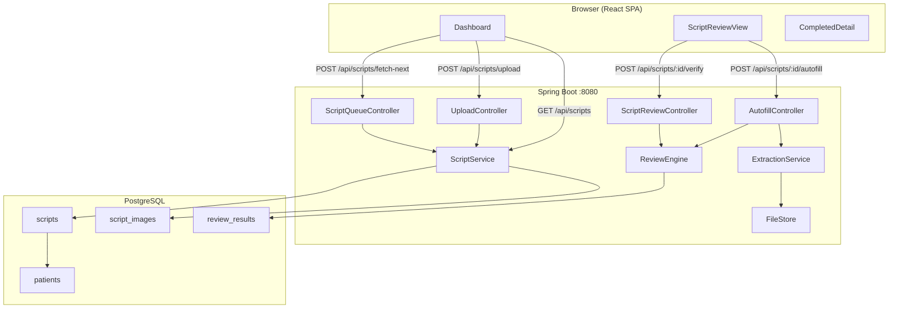
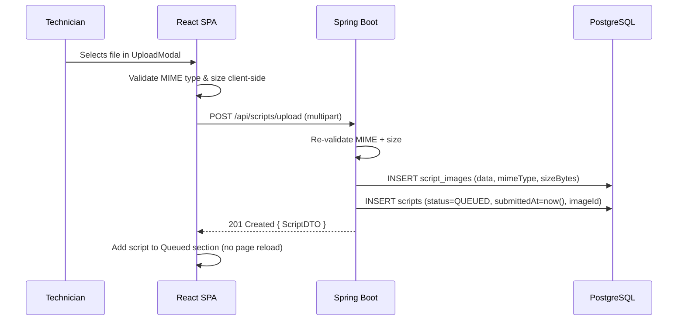
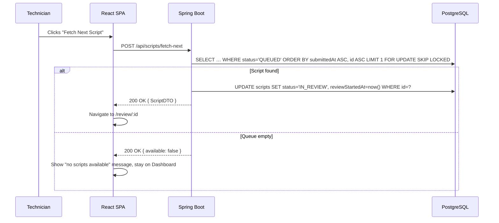

# Design Document

## Overview

AutoScript is a pharmacy script reviewer demo that simulates the two-sided workflow of a pharmacy: a technician uploads a physical prescription image, the system queues it, another technician fetches the next script from the queue, uses autofill to extract fields from the image, reviews and corrects the entry, then submits it for automated verification. The backend applies a suite of dispensing-error checks and returns a structured Review_Result with zero or more flags.

The system is composed of two independently deployable tiers:

- **Frontend** — React 19 single-page application (Vite + TypeScript), served on `localhost:5173` in development
- **Backend** — Spring Boot 4 REST API (Java 17, Spring Data JPA, PostgreSQL), served on `localhost:8080`

All communication between the tiers is over HTTP/JSON via a versioned REST API under the `/api` prefix. The frontend is a pure client; it holds no business logic beyond field validation. All script lifecycle transitions and review checks live in the backend.

The current codebase already has working `Patient` and `Prescription` models, repositories, and controllers for a simpler prescription-entry flow. This design extends those foundations with the full script lifecycle (`QUEUED` → `IN_REVIEW` → `COMPLETED` / `REVIEW_FAILED`), file upload handling, an autofill extraction stub, and the script review engine.

---

## Architecture



### Key design decisions

| Decision | Rationale |
|---|---|
| Atomic fetch-next via `SELECT … FOR UPDATE SKIP LOCKED` | Prevents two concurrent requests from claiming the same script in a race. |
| Extraction as a stubbed service (`ExtractionService`) | Keeps the boundary explicit so a real OCR/LLM integration can be swapped in without touching the review logic. |
| Review flags computed fresh on every Verify/Autofill call | Flags are never cached in-memory; the authoritative result is always persisted to `review_results`. |
| Script images stored as blobs in a dedicated `script_images` table | Avoids filesystem path management in dev; can be swapped for S3 storage later by changing only `FileStore`. |
| Duplicate uploads are always accepted | Per Requirement 1.6 — the system creates a new Script record for each upload regardless of byte-identity. |

---

## Components and Interfaces

### Frontend Components

```
src/
├── App.tsx                      # Router shell, navigation state
├── pages/
│   ├── Dashboard.tsx            # /dashboard — three-column queue view
│   └── ScriptReviewView.tsx     # /review/:id — image + form + flags
├── components/
│   ├── UploadModal.tsx          # Multi-step upload: file → patient → details
│   ├── ScriptCard.tsx           # Reusable row/card for a script entry
│   ├── ReviewFlagList.tsx       # Renders a flags array from Review_Result
│   ├── FieldValidation.tsx      # Per-field validation messages
│   └── shared/
│       ├── Badge.tsx            # Status badge (QUEUED / IN_REVIEW / COMPLETED / …)
│       ├── Spinner.tsx
│       └── ApiErrorBanner.tsx
├── api/
│   └── client.ts                # Central fetch wrapper (apiFetch), typed API calls
└── types/
    └── api.ts                   # TypeScript interfaces mirroring backend DTOs
```

#### Dashboard (`/dashboard`)

Three sections rendered by the same component, each backed by a separate filtered view of the scripts list:

| Section | Scripts shown | Sort order |
|---|---|---|
| Queued | `status === 'QUEUED'` | `submittedAt` ascending |
| In Review | `status === 'IN_REVIEW'` | `reviewStartedAt` ascending |
| Completed | `status === 'COMPLETED'` | `completedAt` descending |

The Dashboard polls `/api/scripts` every 5 seconds so it self-updates without a full reload (satisfies Requirements 6.3 and 7.2).

A "Fetch Next Script" button is enabled only while the Queued section is non-empty; clicking it calls `POST /api/scripts/fetch-next` and navigates to `ScriptReviewView` on success.

#### ScriptReviewView (`/review/:id`)

Split layout: script image on the left (falls back to an error message if the image URL returns a non-2xx), data entry form on the right.

Form fields and their constraints:

| Field | Type | Constraint |
|---|---|---|
| Drug name | text | required, max 200 chars |
| Directions | text | required, max 500 chars |
| Quantity | number | integer or decimal, 1–9999, up to 2 decimal places |
| Day supply | number | positive integer, 1–365 |
| Refill count | number | non-negative integer, 0–99 |
| Prescriber name | text | required, max 100 chars |
| Prescriber NPI | text | exactly 10 digits, numeric |
| Prescriber phone | text | exactly 10 digits, numeric |

The **Verify** button is enabled only when all required fields (`drugName`, `directions`, `quantity`, `daySupply`, `prescriberNPI`) are non-empty. The **Autofill** button is disabled and shows a spinner while a request is in-flight.

After a successful Verify, flags are rendered inline beside their corresponding form fields via `ReviewFlagList`. A success banner is shown when the flags array is empty.

### Backend Components

```
src/main/java/com/springray/autoscript/
├── controllers/
│   ├── ScriptUploadController.java     # POST /api/scripts/upload
│   ├── ScriptQueueController.java      # GET/POST /api/scripts, fetch-next
│   ├── AutofillController.java         # POST /api/scripts/:id/autofill
│   └── ScriptReviewController.java     # POST /api/scripts/:id/verify
├── service/
│   ├── ScriptService.java              # CRUD + fetch-next atomic logic
│   ├── ReviewEngine.java               # Stateless check evaluator
│   └── ExtractionService.java          # Stub: image → field values
├── model/
│   ├── Script.java                     # JPA entity (replaces/extends Prescription for new lifecycle)
│   ├── ScriptImage.java                # JPA entity, stores raw bytes + MIME type
│   └── ReviewResult.java              # JPA entity, one-to-one with Script
├── dto/
│   ├── ScriptDTO.java                  # Response DTO (no image bytes)
│   ├── AutofillResponse.java           # Extracted fields + flags
│   ├── VerifyRequest.java              # Form field values only
│   ├── VerifyResponse.java             # = Review_Result JSON contract
│   └── FlagDTO.java                    # { field, description }
├── validation/
│   ├── ScriptFieldValidator.java       # Field-level constraint checking
│   └── NpiValidator.java               # Luhn check-digit algorithm
└── repository/
    ├── ScriptRepository.java
    ├── ScriptImageRepository.java
    └── ReviewResultRepository.java
```

#### ReviewEngine

A stateless Spring `@Service` that takes a `VerifyRequest` (field values only) and returns a `List<FlagDTO>`. Each check is an isolated `private` method; the public `evaluate()` method collects all non-null results:

| Check | Flag field | Failure condition |
|---|---|---|
| Drug name validity | `drugName` | Not found in a known formulary list |
| Directions completeness | `directions` | Blank or exceeds 500 chars |
| Quantity range | `quantity` | Not in [1, 9999] |
| Day supply consistency | `daySupply` | Derived day supply (quantity / daily-dose parsed from directions) differs from stated value by more than ±1 |
| Prescriber NPI format | `prescriberNpi` | Not exactly 10 digits OR fails Luhn check-digit |

#### ExtractionService (stub)

Returns a `Map<String, String>` of field name → extracted value. In the demo, it returns a hard-coded plausible extraction based on the script's stored image filename/MIME. A real implementation would call an OCR or LLM endpoint here.

---

## Data Models

### Script

Extends the concept of the existing `Prescription` entity with the new lifecycle fields required by the spec. The new `Script` entity will coexist with `Prescription` (legacy UI remains functional).

```java
@Entity
@Table(name = "scripts")
public class Script {
    @Id @GeneratedValue(strategy = GenerationType.IDENTITY)
    Long id;

    @Column(unique = true, nullable = false, length = 20)
    String scriptId;                    // e.g. "SCR-84321"

    @ManyToOne(fetch = FetchType.LAZY)
    @JoinColumn(name = "patient_id")
    Patient patient;                    // optional — linked after autofill or manual entry

    @OneToOne(fetch = FetchType.LAZY, cascade = CascadeType.ALL)
    @JoinColumn(name = "image_id")
    ScriptImage image;

    // ── lifecycle timestamps ────────────────────────────
    LocalDateTime submittedAt;          // set on upload
    LocalDateTime reviewStartedAt;      // set when fetched for review
    LocalDateTime completedAt;          // set when COMPLETED or REVIEW_FAILED

    // ── status ──────────────────────────────────────────
    @Enumerated(EnumType.STRING)
    @Column(nullable = false, length = 20)
    ScriptStatus status;               // QUEUED | IN_REVIEW | COMPLETED | REVIEW_FAILED

    // ── form fields (populated during review) ───────────
    @Column(length = 200) String drugName;
    @Column(length = 500) String directions;
    Integer quantity;
    Integer daySupply;
    Integer refillCount;
    @Column(length = 100) String prescriberName;
    @Column(length = 10)  String prescriberNpi;
    @Column(length = 10)  String prescriberPhone;

    @OneToOne(mappedBy = "script", cascade = CascadeType.ALL)
    ReviewResult reviewResult;
}
```

```java
public enum ScriptStatus {
    QUEUED, IN_REVIEW, COMPLETED, REVIEW_FAILED
}
```

### ScriptImage

```java
@Entity
@Table(name = "script_images")
public class ScriptImage {
    @Id @GeneratedValue(strategy = GenerationType.IDENTITY)
    Long id;

    @Column(nullable = false, length = 50)
    String mimeType;               // "image/jpeg" | "image/png" | "application/pdf"

    @Column(nullable = false)
    Long sizeBytes;

    @Lob
    @Column(nullable = false)
    byte[] data;

    LocalDateTime uploadedAt;
}
```

### ReviewResult

```java
@Entity
@Table(name = "review_results")
public class ReviewResult {
    @Id @GeneratedValue(strategy = GenerationType.IDENTITY)
    Long id;

    @OneToOne
    @JoinColumn(name = "script_id", nullable = false)
    Script script;

    @Enumerated(EnumType.STRING)
    @Column(nullable = false, length = 20)
    ScriptStatus status;              // always COMPLETED when persisted (or REVIEW_FAILED on error)

    LocalDateTime reviewedAt;

    @OneToMany(cascade = CascadeType.ALL, orphanRemoval = true)
    @JoinColumn(name = "result_id")
    List<ReviewFlag> flags;
}
```

### ReviewFlag

```java
@Entity
@Table(name = "review_flags")
public class ReviewFlag {
    @Id @GeneratedValue(strategy = GenerationType.IDENTITY)
    Long id;

    @Column(nullable = false, length = 50)
    String field;                     // e.g. "prescriberNpi"

    @Column(nullable = false, length = 300)
    String description;               // human-readable rule violation + expected format
}
```

### DTO schemas (JSON contract)

**ScriptDTO** (used in all list/fetch responses — no image bytes):
```json
{
  "id": 1,
  "scriptId": "SCR-84321",
  "patientId": 3,
  "patientName": "Sarah Johnson",
  "status": "QUEUED",
  "submittedAt": "2025-07-20T11:00:00",
  "reviewStartedAt": null,
  "completedAt": null,
  "drugName": null,
  "directions": null,
  "quantity": null,
  "daySupply": null,
  "refillCount": null,
  "prescriberName": null,
  "prescriberNpi": null,
  "prescriberPhone": null
}
```

**VerifyResponse / Review_Result** (Requirement 9.1):
```json
{
  "scriptId": "SCR-84321",
  "status": "COMPLETED",
  "reviewedAt": "2025-07-20T11:34:12Z",
  "flags": [
    {
      "field": "prescriberNpi",
      "description": "NPI '1234567890' failed Luhn check-digit validation. Expected a valid 10-digit NPI."
    }
  ]
}
```

**AutofillResponse**:
```json
{
  "extractedFields": {
    "drugName": "Lisinopril 10mg",
    "directions": "Take 1 tablet daily",
    "quantity": "30",
    "daySupply": "30",
    "prescriberName": "Dr. A. Nguyen",
    "prescriberNpi": "1234567893"
  },
  "flags": []
}
```

---

## Sequence Flows

### Upload Flow



### Fetch Next Script Flow



### Autofill Flow

```mermaid
sequenceDiagram
    participant Tech as Technician
    participant UI as React SPA
    participant API as Spring Boot
    participant Extractor as ExtractionService

    Tech->>UI: Clicks Autofill
    UI->>UI: Disable Autofill button, show spinner
    UI->>API: POST /api/scripts/:id/autofill
    API->>Extractor: extract(scriptImage)
    Extractor-->>API: Map<fieldName, value>
    API->>API: Run ReviewEngine.evaluate(extractedFields)
    API-->>UI: 200 OK { AutofillResponse }
    UI->>UI: Populate only returned fields; run field validation
    UI->>UI: Display inline flags; re-enable Autofill button
```

### Verify Flow

```mermaid
sequenceDiagram
    participant Tech as Technician
    participant UI as React SPA
    participant API as Spring Boot
    participant DB as PostgreSQL

    Tech->>UI: Clicks Verify
    UI->>UI: Validate all required fields client-side
    alt Required field missing
        UI->>UI: Show validation messages; do NOT call API
    else All fields present
        UI->>API: POST /api/scripts/:id/verify { VerifyRequest }
        API->>API: ReviewEngine.evaluate(verifyRequest)
        API->>DB: INSERT review_results + review_flags
        API->>DB: UPDATE scripts SET status='COMPLETED', completedAt=now()
        API-->>UI: 200 OK { VerifyResponse }
        alt Zero flags
            UI->>UI: Display "No issues found" success message
        else Flags present
            UI->>UI: Display each flag beside its field
        end
    end
```

---

## Correctness Properties

*A property is a characteristic or behavior that should hold true across all valid executions of a system — essentially, a formal statement about what the system should do. Properties serve as the bridge between human-readable specifications and machine-verifiable correctness guarantees.*

### Property 1: File validation accepts exactly the valid set

*For any* (mimeType, sizeBytes) pair, the upload validation logic accepts the file if and only if the MIME type is one of `image/jpeg`, `image/png`, or `application/pdf` AND sizeBytes ≤ 10,485,760 (10 MB). Any file outside this set is rejected with no Script record created.

**Validates: Requirements 1.1, 1.4**

---

### Property 2: Upload always creates a new script record

*For any* valid file uploaded N times (including byte-for-byte identical files), N distinct Script records are created, each with a unique `scriptId` and `status = QUEUED`.

**Validates: Requirements 1.2, 1.6**

---

### Property 3: Fetch-next always selects the earliest queued script

*For any* non-empty set of QUEUED scripts, `POST /api/scripts/fetch-next` returns the script with the smallest `submittedAt` timestamp (with `id` ascending as the tiebreaker), and that script's status transitions to `IN_REVIEW`.

**Validates: Requirements 2.1, 2.2**

---

### Property 4: Field validation matches defined constraints

*For any* form field and any submitted value, the validation result (accept/reject) matches the constraint specification defined in Requirement 2.4: drug name ≤ 200 chars, directions ≤ 500 chars, quantity ∈ [1, 9999] with up to 2 decimal places, day supply ∈ [1, 365] integer, refill count ∈ [0, 99] integer, NPI = exactly 10 numeric digits, phone = exactly 10 numeric digits.

**Validates: Requirements 2.4, 4.6, 4.7, 4.8, 4.9, 4.10**

---

### Property 5: Verify button enabled iff all required fields are non-empty

*For any* form state, the Verify button is enabled if and only if all required fields (`drugName`, `directions`, `quantity`, `daySupply`, `prescriberNpi`) contain a non-empty, non-whitespace value. If any required field is empty, clicking Verify produces no HTTP request.

**Validates: Requirements 2.5, 4.5**

---

### Property 6: Autofill only overwrites fields it returns

*For any* prior form state and any autofill response, after applying the response: (a) every field present in the response equals the extracted value, and (b) every field absent from the response retains its prior value unchanged.

**Validates: Requirements 3.1, 3.2**

---

### Property 7: Script review flags exactly match failing checks

*For any* `VerifyRequest`, the returned `flags` list contains a flag for every failing check and no flags for passing checks. Specifically:
- A `drugName` flag appears iff the name is not in the formulary
- A `directions` flag appears iff directions is blank or exceeds 500 chars
- A `quantity` flag appears iff quantity is outside [1, 9999]
- A `daySupply` flag appears iff the derived day supply differs from the stated value by more than ±1
- A `prescriberNpi` flag appears iff the NPI is not exactly 10 digits or fails the Luhn algorithm

**Validates: Requirements 5.1, 5.4, 5.5**

---

### Property 8: Dashboard section sort orders are invariant

*For any* set of scripts returned by the API:
- Scripts in the Queued section are rendered in ascending `submittedAt` order
- Scripts in the In Review section are rendered in ascending `reviewStartedAt` order
- Scripts in the Completed section are rendered in descending `completedAt` order

**Validates: Requirements 6.2, 7.1, 8.1**

---

### Property 9: Completed script label is determined by flag count

*For any* completed script, the label displayed in the Dashboard Completed section is `"Passed"` if and only if the script's `flags` array is empty; otherwise the label is `"Needs Attention"`.

**Validates: Requirements 8.2, 8.3**

---

### Property 10: Review_Result JSON schema is always complete

*For any* successful verify response, the JSON body contains all four required fields: a `scriptId` string, a `status` string with value `"COMPLETED"`, a `reviewedAt` ISO-8601 timestamp string, and a `flags` array (which may be empty). Each element of a non-empty `flags` array contains a `field` string and a `description` string.

**Validates: Requirements 9.1, 9.2, 9.3**

---

### Property 11: Script serialization round-trip preserves all fields

*For any* valid `Script` object, serializing it to JSON and deserializing the result produces an object where every field — `scriptId`, `status`, `submittedAt`, `drugName`, `directions`, `quantity`, `daySupply`, `refillCount`, `prescriberName`, `prescriberNpi`, `prescriberPhone` — is equal to the corresponding field in the original.

**Validates: Requirements 9.5**

---

## Error Handling

| Scenario | Backend response | Frontend behavior |
|---|---|---|
| Upload: invalid MIME or size | `422 Unprocessable Entity` with `{ code, message }` | Error banner in UploadModal; no script created |
| Upload: server/storage error | `500 Internal Server Error` | Error banner; user can retry |
| Fetch-next: no scripts available | `200 OK { available: false }` | Toast / banner; stay on Dashboard |
| Autofill: extraction error / timeout | `500` or `504` | Error banner; form unchanged; Autofill re-enabled |
| Verify: required field missing (client) | n/a — no request made | Inline validation messages per field |
| Verify: backend validation failure | `422` with error body | Error banner; status NOT updated |
| Verify: review processing exception | `500`; script set to `REVIEW_FAILED` | Error banner: "Verification could not be completed" |
| Image load failure in review view | `4xx` on image URL | Error placeholder shown; form remains interactive |

All API errors follow a consistent error envelope:
```json
{
  "code": "UPLOAD_FILE_TOO_LARGE",
  "message": "File size 11.2 MB exceeds the 10 MB limit."
}
```

---

## Testing Strategy

### Unit tests (JUnit 5 + Mockito)

Focus on specific scenarios, edge cases, and integration points where property-based testing would be over-engineering:

- `ScriptService.fetchNext()` — verify the correct script is selected from a fixed ordered list
- `ReviewEngine` — verify each check in isolation with boundary values (quantity = 1, quantity = 9999, quantity = 0, quantity = 10000)
- `NpiValidator` — verify Luhn pass/fail with known NPI fixtures
- `ScriptUploadController` — verify 422 on wrong MIME, 422 on oversized file, 500 on storage exception
- `ScriptQueueController` — verify 200 + `available: false` when queue is empty
- `ScriptReviewController` — verify `REVIEW_FAILED` status is persisted on exception

### Property-based tests (jqwik — Java property-based testing library)

Each property test runs a minimum of 100 iterations. Tests are tagged with the format `Feature: script-reviewer-demo, Property N: <property text>` for traceability.

#### Property 1 — File validation

```java
// Feature: script-reviewer-demo, Property 1: File validation accepts exactly the valid set
@Property(tries = 200)
void fileValidationAcceptsExactlyValidSet(
    @ForAll("mimeTypes") String mime,
    @ForAll @LongRange(min = 0, max = 20_000_000) long sizeBytes) {

    boolean expected = List.of("image/jpeg","image/png","application/pdf").contains(mime)
                       && sizeBytes <= 10_485_760;
    assertEquals(expected, FileValidator.isAccepted(mime, sizeBytes));
}
```

#### Property 2 — Upload creates distinct records

```java
// Feature: script-reviewer-demo, Property 2: Upload always creates a new script record
@Property(tries = 100)
void uploadAlwaysCreatesDistinctRecord(@ForAll @IntRange(min = 1, max = 10) int n) {
    byte[] bytes = "test".getBytes();
    List<String> ids = IntStream.range(0, n)
        .mapToObj(_ -> scriptService.upload("image/jpeg", bytes).getScriptId())
        .toList();
    assertEquals(n, new HashSet<>(ids).size());
    ids.forEach(id -> assertEquals(ScriptStatus.QUEUED, scriptService.findByScriptId(id).getStatus()));
}
```

#### Property 3 — Fetch-next returns earliest queued

```java
// Feature: script-reviewer-demo, Property 3: Fetch-next always selects the earliest queued script
@Property(tries = 100)
void fetchNextReturnsEarliestQueued(@ForAll("queuedScripts") List<Script> scripts) {
    Assume.that(!scripts.isEmpty());
    scripts.forEach(scriptRepository::save);
    Script fetched = scriptService.fetchNext().orElseThrow();
    Script earliest = scripts.stream()
        .min(Comparator.comparing(Script::getSubmittedAt).thenComparing(Script::getId))
        .orElseThrow();
    assertEquals(earliest.getScriptId(), fetched.getScriptId());
    assertEquals(ScriptStatus.IN_REVIEW, fetched.getStatus());
}
```

#### Property 4 — Field validation matches constraints

```java
// Feature: script-reviewer-demo, Property 4: Field validation matches defined constraints
@Property(tries = 300)
void fieldValidationMatchesConstraints(
    @ForAll("fieldNames") String field,
    @ForAll("fieldValues") String value) {

    boolean result = ScriptFieldValidator.validate(field, value);
    boolean expected = ConstraintSpec.isValid(field, value);
    assertEquals(expected, result);
}
```

#### Property 5 — Verify enabled iff all required fields present

```java
// Feature: script-reviewer-demo, Property 5: Verify button enabled iff all required fields non-empty
@Property(tries = 200)
void verifyEnabledIffAllRequiredFieldsPresent(@ForAll("formStates") Map<String, String> state) {
    boolean allPresent = REQUIRED_FIELDS.stream()
        .allMatch(f -> state.getOrDefault(f, "").strip().length() > 0);
    assertEquals(allPresent, FormStateEvaluator.isVerifyEnabled(state));
}
```

#### Property 6 — Autofill only overwrites returned fields

```java
// Feature: script-reviewer-demo, Property 6: Autofill only overwrites fields it returns
@Property(tries = 200)
void autofillOnlyOverwritesReturnedFields(
    @ForAll("formStates") Map<String, String> prior,
    @ForAll("partialExtractions") Map<String, String> extracted) {

    Map<String, String> result = AutofillMerger.merge(prior, extracted);
    extracted.forEach((k, v) -> assertEquals(v, result.get(k)));
    prior.forEach((k, v) -> {
        if (!extracted.containsKey(k)) assertEquals(v, result.get(k));
    });
}
```

#### Property 7 — Review flags match failing checks exactly

```java
// Feature: script-reviewer-demo, Property 7: Script review flags exactly match failing checks
@Property(tries = 200)
void reviewFlagsMatchFailingChecks(@ForAll("verifyRequests") VerifyRequest req) {
    List<FlagDTO> flags = reviewEngine.evaluate(req);
    Set<String> flagFields = flags.stream().map(FlagDTO::field).collect(toSet());

    assertEquals(!Formulary.contains(req.drugName()), flagFields.contains("drugName"));
    assertEquals(req.directions() == null || req.directions().isBlank() || req.directions().length() > 500,
                 flagFields.contains("directions"));
    assertEquals(req.quantity() == null || req.quantity() < 1 || req.quantity() > 9999,
                 flagFields.contains("quantity"));
    assertEquals(!NpiValidator.isValid(req.prescriberNpi()), flagFields.contains("prescriberNpi"));
}
```

#### Property 8 — Dashboard sort orders

```java
// Feature: script-reviewer-demo, Property 8: Dashboard section sort orders are invariant
@Property(tries = 100)
void queuedSectionSortedAscending(@ForAll("scriptLists") List<Script> scripts) {
    List<Script> queued = scripts.stream().filter(s -> s.getStatus() == QUEUED).toList();
    List<Script> displayed = DashboardSorter.sortQueued(queued);
    for (int i = 0; i < displayed.size() - 1; i++) {
        assertTrue(
            displayed.get(i).getSubmittedAt()
                .compareTo(displayed.get(i + 1).getSubmittedAt()) <= 0
        );
    }
}
```

#### Property 9 — Completed script label

```java
// Feature: script-reviewer-demo, Property 9: Completed script label determined by flag count
@Property(tries = 100)
void completedLabelDeterminedByFlagCount(@ForAll("reviewResults") ReviewResult result) {
    String label = DashboardLabelAssigner.assign(result);
    assertEquals(result.getFlags().isEmpty() ? "Passed" : "Needs Attention", label);
}
```

#### Property 10 — Review_Result JSON schema completeness

```java
// Feature: script-reviewer-demo, Property 10: Review_Result JSON schema is always complete
@Property(tries = 100)
void reviewResultSchemaIsComplete(@ForAll("verifyRequests") VerifyRequest req) throws Exception {
    ReviewResult result = reviewEngine.buildResult("SCR-00001", req);
    String json = objectMapper.writeValueAsString(result);
    JsonNode node = objectMapper.readTree(json);

    assertTrue(node.has("scriptId"));
    assertTrue(node.has("status"));
    assertEquals("COMPLETED", node.get("status").asText());
    assertTrue(node.has("reviewedAt"));
    assertTrue(node.has("flags"));
    assertTrue(node.get("flags").isArray());

    node.get("flags").forEach(flag -> {
        assertTrue(flag.has("field"));
        assertTrue(flag.has("description"));
    });
}
```

#### Property 11 — Script JSON round-trip

```java
// Feature: script-reviewer-demo, Property 11: Script serialization round-trip preserves all fields
@Property(tries = 100)
void scriptSerializationRoundTrip(@ForAll("validScripts") Script original) throws Exception {
    String json = objectMapper.writeValueAsString(ScriptDTO.from(original));
    ScriptDTO deserialized = objectMapper.readValue(json, ScriptDTO.class);

    assertEquals(original.getScriptId(),      deserialized.scriptId());
    assertEquals(original.getStatus().name(),  deserialized.status());
    assertEquals(original.getDrugName(),       deserialized.drugName());
    assertEquals(original.getDirections(),     deserialized.directions());
    assertEquals(original.getQuantity(),       deserialized.quantity());
    assertEquals(original.getDaySupply(),      deserialized.daySupply());
    assertEquals(original.getRefillCount(),    deserialized.refillCount());
    assertEquals(original.getPrescriberName(), deserialized.prescriberName());
    assertEquals(original.getPrescriberNpi(),  deserialized.prescriberNpi());
    assertEquals(original.getPrescriberPhone(),deserialized.prescriberPhone());
}
```

### Integration tests

- Upload → Fetch Next → Autofill → Verify end-to-end with an in-memory H2 database (swap `application-test.properties`)
- Concurrent `fetch-next` calls (two threads) result in exactly one script claimed each, no duplicate `IN_REVIEW` assignments
- `REVIEW_FAILED` persisted on exception; subsequent re-verify allowed (script status transitions back to `IN_REVIEW` first)
